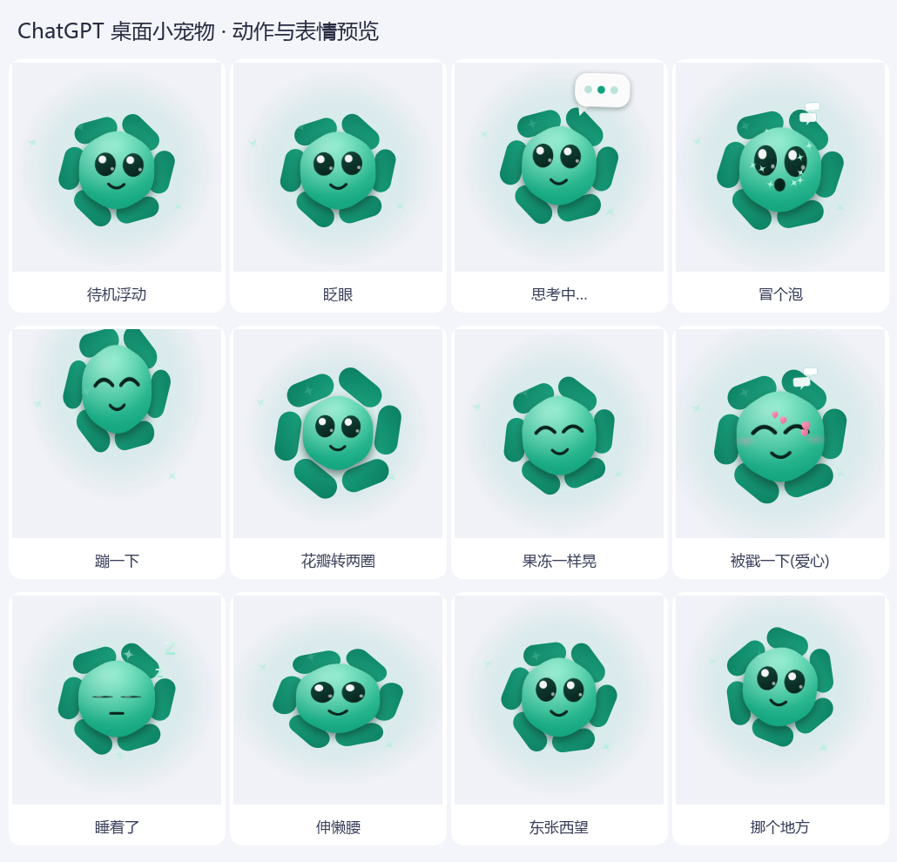

# ChatGPTPet

一只常驻 Windows 桌面的 **ChatGPT 小花精灵**（OpenAI 花标造型）：花瓣会慢慢自转，想事情时会冒出“正在输入…”的三个点，戳一下还会蹦、会冒爱心。

**零依赖**：只用系统自带的 WPF + PowerShell 5.1，不需要安装 Python / Node / 任何运行库。

## 快速开始

1. 下载本仓库（或只下载 `ChatGPTPet/` 目录）
2. 双击 **`ChatGPTPet/启动宠物.vbs`**（无黑框；若被杀软拦截就用 `启动宠物.bat`）
3. 退出：右键点小宠物 → **❌ 退出**

它会出现在屏幕右下角：戳一下有反应、按住左键可拖动、右键有菜单（打招呼 / 摸摸头 / 思考一下 / 冒个泡 / 大小 / 挪个地方 / 退出），75 秒没人理会自己睡着。
玩法细节、命令行参数、开机自启、技术实现与常见问题都在 **[ChatGPTPet/README.md](ChatGPTPet/README.md)**。

## 目录结构

| 路径 | 说明 |
| --- | --- |
| `ChatGPTPet/ChatGPTPet.ps1` | 主程序（造型 + 动画 + 交互都在这一个文件里） |
| `ChatGPTPet/启动宠物.vbs` / `启动宠物.bat` | 启动器（vbs 无黑框，bat 为备用） |
| `ChatGPTPet/预览外观.bat` | 重新渲染预览图 |
| `ChatGPTPet/preview/` | 12 张动作/表情预览图 + 预览合集 + 桌面实拍 + 右键菜单实拍 |
| `ChatGPTPet/tools/` | 开发辅助：截屏 / 模拟点击拖动验证、生成图标与合集图 |
| `ChatGPTPet/build/` | 开发辅助：由「已验证框架 + 花朵代码块」组装主程序 |
| `LICENSE` | MIT |

## 系统要求

* Windows 10 / 11（自带 WPF + PowerShell 5.1 即可）
* 首次运行可能被安全软件拦截，把目录加入白名单即可

## License

[MIT](LICENSE)
