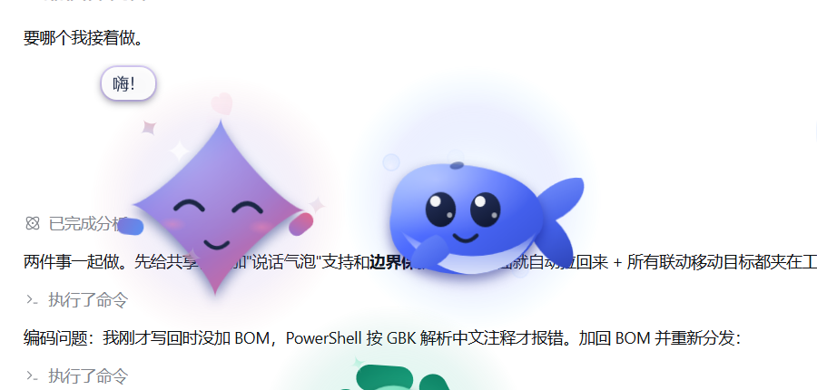
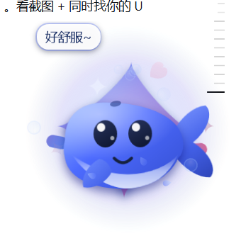

# ChatGPT 桌面小宠物 ✦

> 📦 **免安装下载**：[Releases](https://github.com/qi-cluadld/ChatGPTPet/releases/latest) 下载 zip，解压后双击 `启动宠物.vbs` 即可（不用 clone、不用装任何运行库）。


一只 OpenAI 花标造型的六瓣小花精灵,常驻在桌面角落:花瓣会慢慢自转,想事情的时候还会冒出"正在输入…"的三个点。

**零依赖**:只用 Windows 自带的 WPF + PowerShell,不用装 Python / Node / 任何运行库。


---

## 快速开始

| 方式 | 操作 |
| --- | --- |
| 推荐 | 双击 **`启动宠物.vbs`**(无黑框,启动后直接出现) |
| 备用 | 双击 **`启动宠物.bat`**(若 .vbs 被杀软/策略拦截) |
| 命令行 | `powershell -NoProfile -ExecutionPolicy Bypass -File ChatGPTPet.ps1` |
| 退出 | 右键点小花 → **❌ 退出**(或任务管理器结束该 powershell 进程) |

启动后它会出现在**屏幕右下角**。重复启动不会开第二朵(单实例锁;想开多朵加 `-AllowMultiple`)。
和 `GeminiPet`、`DeepSeekPet` 互不影响,**三只可以同时养**。

---

## 怎么和它玩

| 操作 | 效果 |
| --- | --- |
| **左键点一下** | 戳它 → 随机反应:蹦一下 / 花瓣转两圈 / 冒个泡 / 冒爱心,并露出笑脸腮红 |
| **按住左键拖动** | 拖到桌面上任何位置(1:1 跟手,拖动会打断它正在做的动作) |
| **右键** | 菜单:打个招呼 · 摸摸头 · 思考一下 · 冒个泡 · 去睡觉 · 大小(小/中/大) · 挪个地方 · 退出 |
| 放着不管 | 每隔几秒随机做小动作;**75 秒**没人理它会睡着(冒 Z),戳一下叫醒 |

它会做的动作:花瓣慢慢自转(待机常态)、**思考中…**(冒出正在输入的三点气泡,花瓣飞快旋转)、冒个泡、蹦一下、花瓣转两圈、果冻一样晃、伸懒腰、东张西望、挪个地方、睡觉。

---

## 命令行参数

```powershell
# 加大体型(0.7 / 1.0 / 1.4 都可以)

> 📦 **免安装下载**：[Releases](https://github.com/qi-cluadld/ChatGPTPet/releases/latest) 下载 zip，解压后双击 `启动宠物.vbs` 即可（不用 clone、不用装任何运行库）。

powershell -NoProfile -ExecutionPolicy Bypass -File ChatGPTPet.ps1 -Size 1.4

# 重新渲染 12 张动作预览图到 preview\ 目录(也可直接双击 预览外观.bat)

> 📦 **免安装下载**：[Releases](https://github.com/qi-cluadld/ChatGPTPet/releases/latest) 下载 zip，解压后双击 `启动宠物.vbs` 即可（不用 clone、不用装任何运行库）。

powershell -NoProfile -ExecutionPolicy Bypass -File ChatGPTPet.ps1 -Preview .\preview

# 渲染带透明通道的预览图(用来做图标)

> 📦 **免安装下载**：[Releases](https://github.com/qi-cluadld/ChatGPTPet/releases/latest) 下载 zip，解压后双击 `启动宠物.vbs` 即可（不用 clone、不用装任何运行库）。

powershell -NoProfile -ExecutionPolicy Bypass -File ChatGPTPet.ps1 -Preview .\preview -PreviewAlpha

# 自检:跑 20 秒,自动把所有动作演一遍,检查有没有报错

> 📦 **免安装下载**：[Releases](https://github.com/qi-cluadld/ChatGPTPet/releases/latest) 下载 zip，解压后双击 `启动宠物.vbs` 即可（不用 clone、不用装任何运行库）。

powershell -NoProfile -ExecutionPolicy Bypass -File ChatGPTPet.ps1 -SelfTest 20

# 允许开多朵 / 允许点击时抢焦点(默认不抢)

> 📦 **免安装下载**：[Releases](https://github.com/qi-cluadld/ChatGPTPet/releases/latest) 下载 zip，解压后双击 `启动宠物.vbs` 即可（不用 clone、不用装任何运行库）。

powershell ... -File ChatGPTPet.ps1 -AllowMultiple
powershell ... -File ChatGPTPet.ps1 -ActivateOnClick
```

---

## 让它开机自动出现

1. `Win + R` → 输入 `shell:startup` → 回车(打开"启动"文件夹)
2. 把 `启动宠物.vbs` 的**快捷方式**拖进去
3. 想让它更好看:右键快捷方式 → 属性 → 更改图标 → 选本目录的 `chatgpt_pet.ico`

---

## 三只桌宠联动

三只桌宠(Gemini ✨ / DeepSeek 🐋 / ChatGPT ✦)现在会互相"看见"对方:它们通过一块命名共享内存 `DesktopPets.Interop.v1` 交换自己的窗口位置与状态,**不需要任何后台服务**,谁在跑就跟谁联动。

| 联动行为 | 表现 |
| --- | --- |
| 👋 见面打招呼 | 靠近到约一个身位时,两只都会转头看过去、露出笑脸腮红并冒爱心(对方睡着了还会把它叫醒) |
| 👀 对视 | 待在一起时眼睛持续朝对方的方向偏,身体也会轻微侧倾 |
| 🎉 一起玩 | 挨着时每隔一会儿一起做动作(星星挥手转圈 / 鲸鱼翻滚冒泡 / 小花转圈撒星),一边发起、另一只几秒内跟上 |
| 🚶 串门 | 离得远时偶尔主动挪到另一只旁边待着,到了再打个招呼 |
| ↔️ 主动让位 | 挤成一坨时会自己让开一点,三只不会再叠在同一个角落 |
| 💬 说话气泡 | 打招呼 / 一起玩 / 串门 / 被戳 / 一个人发呆时都会冒一句台词,每只宠物有自己的口头禅(在 `Lines` 里改) |
| 🗣 真·对话 | 靠近时会一问一答聊 2~3 个回合(打招呼 → 回应 → 再聊一句 → 回应 → 道别),各自用自己的台词表 |
| ❤ 传爱心 | 偶尔送对方一颗小心心,对方会接住并回一句谢谢 |
| 🏃 追逐 | 中距离时偶尔追过去,被追的有一半概率会跑开,追上就一起玩 |
| 📏 排排站 | 挨在一起时会慢慢对齐高度,看起来像并排站着 |
| 🧠 话题记忆 | 每次聊天会挑一个话题(开场 → 回应 → 追问 → 回应 → 道别),而且记得上次聊到哪儿:被打断的话题下次见面接着聊,同一个话题不会连着聊两次 |
| 😤 吵架与和好 | 被同一个人反复追会追烦 → 生气(不理人、躲开),对方看到会道歉并送颗小心心,气消了就**和好**、冒爱心继续玩 |

**台词表已外置**:每个宠物目录下的 `lines.json` 就是它全部台词(问候 / 对话 / 被摸 / 发呆 / 送爱心…),`{me}` 和 `{you}` 会被替换成双方名字(小星星 / 小鲸鱼 / 小花),用记事本改完保存、重启宠物就生效;删掉这个文件会退回脚本内置的默认台词。
另外它们有**边界保护**:联动移动或手动拖动导致宠物中心跑出屏幕时,下一帧就会自己拉回工作区(日志里记一条「边界保护」),所以不会再出现"跑出桌面找不回来"的情况。台词表在各宠物脚本注册的 `Lines` 哈希里,想换口头禅改那里即可。
只开一只时联动完全不触发;想关掉就把本目录里的 `social.ps1` 删掉(脚本检测不到会自动跳过,其余功能不受影响)。






> 实现说明:三个仓库各有一份相同的 `social.ps1`(共享内存通信 + 社交状态机),每只宠物在里面注册自己的「打招呼 / 一起玩 / 看向对方 / 移动到某处」钩子。改动这个文件请同步三个仓库。
## U 盘热插拔自动备份

插上 U 盘就自动把三只宠物同步过去,不用手动拷:

1. 双击任意一个宠物目录里的 `启动U盘备份.vbs`(无窗口,后台运行)
2. 之后每次插入 U 盘,都会自动备份到 `<U盘>\桌面小组件\`,并写下 `备份信息.txt` 记录时间与文件数
3. 想开机就监控:右键 `启动U盘备份.vbs` → 发送到 → 桌面快捷方式,再把快捷方式放进 `shell:startup`

命令行:`powershell -NoProfile -ExecutionPolicy Bypass -File tools\usb_backup.ps1 [-Once] [-IntervalSec 5]`;日志写在 `%TEMP%\USB备份.log`。
## 技术说明

* **纯 WPF 矢量绘制**:花心是圆角六边形(贝塞尔路径由代码按正多边形+圆角算法生成),六片花瓣是圆角长条,围一圈各扭转 12°,做出花标那种咬合感;主色是 OpenAI 品牌绿 `#10A37F`(亮部 `#62E3B8` → 暗部 `#0A7A5E`)。花瓣和花心共用一束**绝对坐标的径向渐变**,所以整体光影是统一的,而不是每片各亮一坨。
* **待机亮点**:花瓣以 7°/秒 慢慢自转;"思考中"时提到 108°/秒,并弹出白底气泡,里面三个点依次亮起——就是 ChatGPT 那个"正在输入"。
* **分层窗口**(`AllowsTransparency` + 每像素 Alpha):没有方形背景,阴影和柔光直接叠在桌面上。
* **不抢焦点**:窗口加了 `WS_EX_NOACTIVATE | WS_EX_TOOLWINDOW`,点它、拖它都不会把你正在打字的窗口切走。
* **高 DPI**:启动时申请 Per-Monitor-V2 DPI 感知,125% / 150% 缩放下依然清晰,拖动位移按 DPI 换算。
* **性能**:30fps 定时器驱动,整只宠物用 `BitmapCache` 缓存位图,逐帧只做合成;实测**约 3~5% 单核 CPU、约 130MB 内存**。
* **踩过的坑(重要)**:WPF 的 `BitmapCache` **不会因为子元素被"代码新增"而刷新**——六片花瓣是代码里生成的,若把它们加在带缓存的 `Pet` 画布**内部**,整个宠物会被渲染成一片空白(桌面上只剩粒子特效)。所以花瓣层 `BlossomLayer` 必须放在缓存画布**之外**,它仍随宠物一起漂浮旋转。以后往这只宠物里加"代码生成"的元素时也要遵守这条。
* **踩过的坑(二)**:动作结束时 `End-State` 会把 `StateT/StateDur` 清零,而同一帧里局部变量 `$st` 还是旧状态名 —— 此时再做 `StateT/StateDur` 就是 `0/0 = NaN`,一旦写进 `RotateTransform.Angle`,**WPF 会整个元素都不渲染**(表现为花瓣凭空消失,而且 NaN 会一直传下去,要等下一次旋转重新赋值才恢复)。所以这处判断改用 `$script:State` 并加了 `StateDur > 0` 守卫,另外给所有写进变换的值加了 NaN/Infinity 兜底。
* **出错不影响你**:每帧更新都包了异常捕获,异常写进日志 `%TEMP%\ChatGPTPet.log`。

---

## 文件结构

```
ChatGPTPet\
├─ ChatGPTPet.ps1       主程序(造型 + 动画 + 交互都在这一个文件里)
├─ 启动宠物.vbs         推荐启动方式(无黑框)
├─ 启动宠物.bat         备用启动方式
├─ 预览外观.bat         重新渲染 preview\ 里的预览图
├─ chatgpt_pet.ico      图标(可用作快捷方式图标)
├─ chatgpt_pet.png      图标 PNG 版
├─ preview\             12 张动作/表情预览图 + 桌面实拍 + 右键菜单实拍 + 预览合集.png
├─ tools\               开发辅助:截屏/模拟点击拖动验证、生成图标与合集图
└─ build\               开发辅助:由已验证框架 + 花朵代码块组装本程序的脚本
```

> `build\` 是"造程序"的工具:透明窗口/DPI/拖动/定时器那套框架在前面两只宠物上已经验证过,
> 换角色时用 `build.ps1` 把框架和新的花朵外观/动作/菜单拼装起来,避免重复踩坑。
> 平时使用完全不需要它。

---

## 常见问题

* **双击没反应?** 先看 `%TEMP%\ChatGPTPet.log`;再改用 `启动宠物.bat`;若被杀软拦截,把该目录加入白名单。
* **已经有一朵了,再点没反应?** 单实例保护,属正常现象(想开多朵加 `-AllowMultiple`)。
* **看不到它?** 可能挪到(或被拖到)屏幕边缘外了,结束进程重新启动即可回到右下角。
* **改了代码没生效?** 先退出正在运行的那朵,再重新启动。
